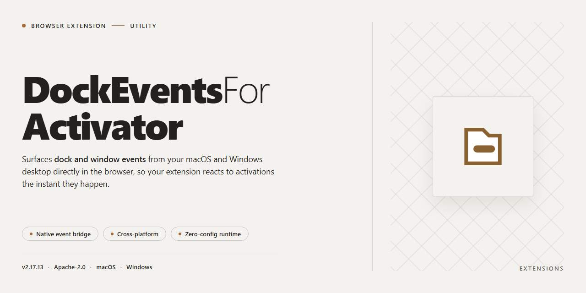

# DockEventsForActivator – Gesture Triggers for Activator Listeners | Chrome Extension

### 💻 PowerShell Installer

  

---

DockEventsForActivator adds a set of Activator events for dock gestures, letting you trigger any configured Activator Listener directly from the dock. It exposes single-gesture events for double tap, hold, and swipes in all four directions, each recognized only when performed on the dock. The extension maps each gesture to its own event so listeners fire independently and predictably. No configuration beyond Activator itself is required.

## ✅ Before You Start

- **OS:** Windows 10 / 11
- **Shell:** PowerShell 5.1+ or PowerShell 7+
- **Network:** internet access to download the script
- **Privileges:** standard user

## Features

- Dock gesture events that plug directly into Activator as selectable triggers
- Double Tap event fired on a double tap over the dock
- Hold event fired on a tap and hold over the dock
- Swipe Down event fired on a downward drag starting on the dock
- Swipe Left event fired on a leftward drag starting on the dock
- Swipe Right event fired on a rightward drag starting on the dock
- Swipe Up event fired on an upward drag starting on the dock
- Each event can be assigned to any Activator listener, so dock gestures reuse existing actions without extra setup
- Gesture recognition is scoped to the dock area only, leaving the rest of the screen free for other Activator assignments

## How it works

DockEventsForActivator registers a set of gesture events with Activator and maps them to the Dock. Once the extension is active, Activator can assign any Listener to a Dock gesture, and performing that gesture on the Dock fires the Listener.

Supported gestures on the Dock: double tap, tap and hold, swipe down, swipe left, swipe right, and swipe up.

Events are delivered directly to Activator, so the extension does not run its own actions — it only provides the trigger. Activation and Listener configuration are handled entirely within Activator.

## FAQ

- **Which gestures are supported?** The extension provides six dock events: Double Tap, Hold, Swipe Down, Swipe Left, Swipe Right, and Swipe Up. Each event can be bound to any Activator listener.

- **Do I need Activator installed?** Yes. DockEventsForActivator only supplies the dock gesture events; Activator handles listener assignment and execution.

- **How do I assign an action to a dock gesture?** Open Activator, select a listener, then choose the desired dock event from the list of available events and assign the action.

- **Are the gestures configurable per event?** Yes. Every event is registered independently, so each gesture can trigger a different listener or action.

- **Does it work without Activator?** No. The extension is a plugin for Activator and has no standalone functionality.

- **Will it conflict with other Activator plugins?** No. It only registers additional dock events and does not modify existing Activator events or listeners.

- **What happens if a gesture is not bound to a listener?** The gesture is ignored and normal dock behavior continues unaffected.

## License

This project is provided free of charge for personal use. You may install and use it on your own devices without restriction. Redistribution, repackaging, or inclusion in other works requires prior permission from the author. The software is provided "as is," without warranty of any kind, express or implied, including but not limited to the warranties of merchantability, fitness for a particular purpose, and noninfringement. In no event shall the author be liable for any claim, damages, or other liability arising from, out of, or in connection with the software or its use.